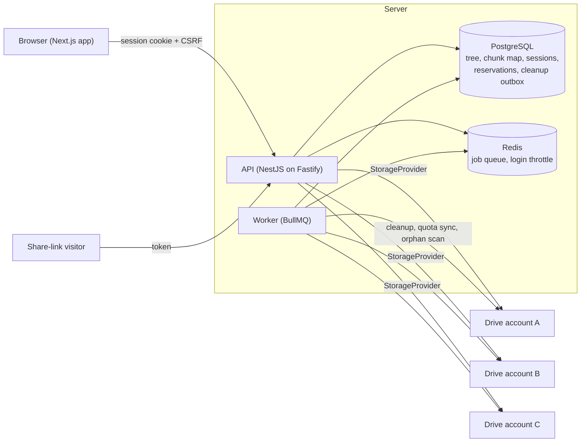
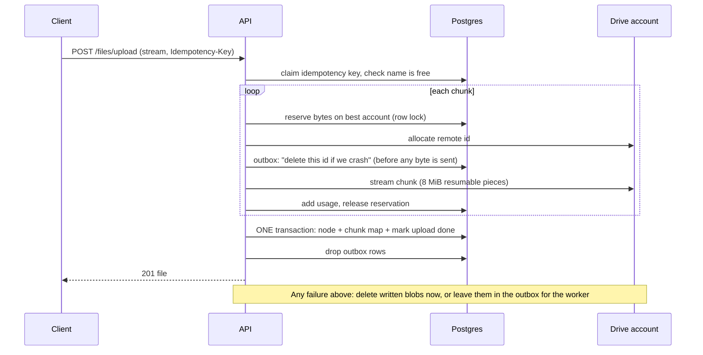

# Architecture

PoolDrive presents several Google Drive accounts as one storage pool. The folder tree, names and permissions live
**only in Postgres**. Google holds opaque blobs named by random UUIDs inside one app folder per account, so a person with
access to a Drive account sees no file names and cannot reconstruct anything from it.

## Components

- **API** (`apps/api`): authentication, the virtual filesystem, the upload and download pipelines, sharing, metrics.
  Every byte of file content streams through it; browsers never talk to Google for file data.
- **Worker** (`apps/worker`): scheduled jobs from `apps/api/src/jobs` (quota sync every 5 minutes by default, cleanup
  every minute, trash auto-purge and session purge hourly, orphan scan daily). Schedules live in Redis, so several workers
  never duplicate them.
- **Web** (`apps/web`): the Drive-style UI (Phase 3).
- **Shared** (`packages/shared`): the validated configuration and domain constants.

## The storage core (`apps/api/src/storage`)

| Piece                         | Job                                                                                                                                                                                                                                |
| ----------------------------- | ---------------------------------------------------------------------------------------------------------------------------------------------------------------------------------------------------------------------------------- |
| `StorageProvider`             | The only thing that knows about Google: `allocateId`, `upload`, `download` (with range), `delete`, `getQuota`, `listBlobs`, `healthCheck`. Implementations: `GoogleDriveProvider`, `FakeProvider` (tests, `STORAGE_PROVIDER=fake`) |
| `PlacementStrategy`           | Chooses the account for the next bytes. Default `MostFreeSpaceStrategy`; swap it without touching anything else                                                                                                                    |
| `AccountStore` + reservations | Atomic "reserve N bytes on account X" under a row lock, so concurrent uploads can never oversubscribe an account                                                                                                                   |
| `UploadService`               | Streams a file into the pool and commits metadata atomically, or removes everything it wrote                                                                                                                                       |
| `DownloadService`             | Streams chunks in order, verifying each chunk's SHA-256 and, when encrypted, its GCM tag                                                                                                                                           |
| `CleanupService` + outbox     | Deletes remote blobs that were left behind or belong to purged files                                                                                                                                                               |
| `QuotaSyncService`            | Reads real quota from Drive (shared with Gmail and Photos) and degrades accounts whose credentials fail                                                                                                                            |
| `OrphanScanner`               | Compares Drive with the database and reports differences. It never deletes                                                                                                                                                         |
| `KeyRing`                     | AES-256-GCM key wrapping and secret sealing with rotatable master keys                                                                                                                                                             |

### Where a file goes

1. **Fits one account** (unencrypted): stored whole in the account with the most free space. Downloads support `Range`.
2. **Does not fit one account**: split into chunks (64 MiB by default). Before each chunk the pool is re-checked, and when
   no account has room for a full chunk the chunk **shrinks to what the best account has left**, so no free space is
   stranded. This is what lets three accounts with 1 GB free each accept a 3 GB file.
3. **Encrypted**: always stored as records of at most 16 MiB (`ENCRYPTED_CHUNK_BYTES`). Each record is AES-256-GCM with a
   random nonce; the per-file key is wrapped by the master key and stored with its key id.

### Upload sequence

The outbox row is written **before** bytes are sent, using an id Drive allocated in advance (`files.generateIds`). A crash
at any point therefore leaves a record the worker can act on; nothing is ever left untracked.

## Failure model

- **Account revoked or token expired** (`invalid_grant`, 401): the account becomes `DEGRADED` as soon as a request, or the
  next quota sync, notices. It is excluded from placement, an alert is raised, and files with any chunk on it return
  `503 file_unavailable` with an explanation. Metadata is never deleted. Re-authorising from the Storage page restores it.
- **Transient errors** (429, 5xx, network): retried with exponential backoff and full jitter. Three consecutive failed quota
  syncs degrade an account.
- **No redundancy in v1.** A file split across accounts is unavailable while any account holding a piece is down. The UI says
  so. `ChunkCodec`/erasure coding is the planned extension point.
- **Integrity:** every chunk is checked against its stored SHA-256. Encrypted records are additionally authenticated by GCM,
  with the file id, record index and an "is last" flag in the authenticated data, which blocks reordering, splicing between
  files and truncation.

## Data model

See `docs/PLAN.md` section 2 for the table list. Notable constraints:

- `nodes`: unique `(owner, parent, name)` among **live** siblings (partial index; the root uses a sentinel UUID), so a name
  can be reused after trashing the old item. Trashing marks the whole subtree with `trash_root_id`.
- `file_chunks`: primary key `(file_id, index)`; `account_id` and `remote_id` say where each piece lives.
- `uploads`: unique `(owner, idempotency_key)`.
- `remote_cleanup`: the outbox, with retry backoff.
- `share_links`: only the SHA-256 of the token is stored.

## Observability

JSON logs (pino) with request ids; authorization headers, cookies and passwords are redacted and key material is never
logged. `/metrics` exposes process metrics, request durations by route template, and pool gauges (accounts by status,
capacity, usage) computed at scrape time.
